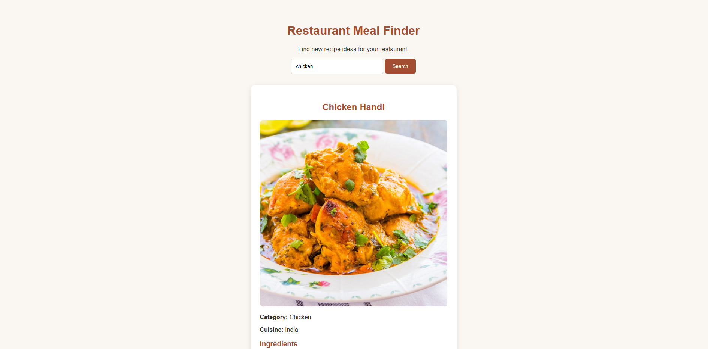
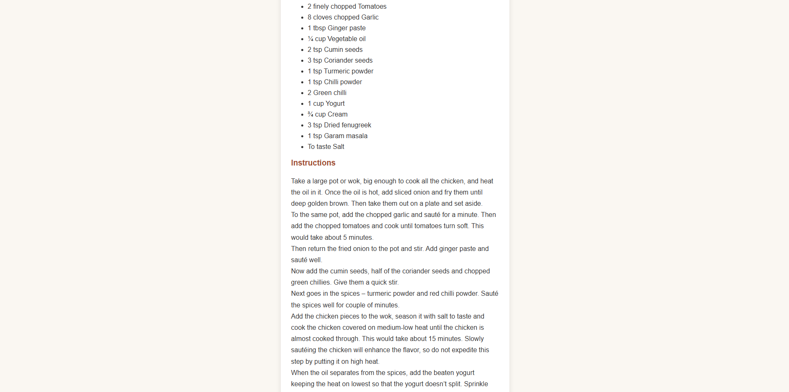

# Restaurant Meal Finder

A recipe discovery application designed to help restaurant staff, chefs, and food enthusiasts explore new meal ideas.

Built with HTML, CSS, and JavaScript, the application integrates TheMealDB API to retrieve recipes and display ingredients, measurements, cuisine information, and step-by-step cooking instructions in a clean interface.

## Live Demo

**[Explore Restaurant Meal Finder](https://anwaralshohatee.github.io/restaurant-app-/)**

## Technologies


## Features

- Search for recipes by meal name
- Retrieve recipe information from TheMealDB API
- Display the first matching recipe
- Show meal photos, categories, and cuisine origins
- Generate ingredient lists with corresponding measurements
- Display detailed cooking instructions
- Dynamically update results without reloading the page
- Validate empty searches
- Display loading, no-results, and error messages
- Present recipes in a responsive card layout

## Screenshots

### Recipe Search and Details



### Ingredients and Cooking Instructions



## How It Works

1. Enter a meal name, such as `chicken`.
2. Click **Search**.
3. The application sends a request to TheMealDB API.
4. The API returns matching recipes.
5. The application selects the first matching recipe.
6. JavaScript processes the ingredients and measurements.
7. The recipe image, category, cuisine, ingredients, and instructions are displayed.

## API Used

### TheMealDB API

TheMealDB provides recipe information, including meal names, images, ingredients, measurements, cuisine categories, and cooking instructions.

**API Website:** https://www.themealdb.com/api.php

The application uses the meal search endpoint:

```text
https://www.themealdb.com/api/json/v1/1/search.php?s=chicken
```

## Getting Started

### 1. Clone the Repository

```bash
git clone https://github.com/AnwarAlshohatee/restaurant-app-.git
cd restaurant-app-
```

### 2. Run the Application

Open `index.html` in your browser.

No additional installations or dependencies are required.

An internet connection is required to retrieve recipe information.

## Future Improvements

- Display multiple matching recipes
- Add filtering by cuisine and meal category
- Allow users to save favorite recipes
- Add random recipe suggestions
- Support ingredient-based searches
- Improve accessibility and keyboard navigation

## Author

**Anwar Alshohatee**

[Portfolio](https://anwaralshohatee.netlify.app) | [LinkedIn](https://www.linkedin.com/in/anwaralshohatee/)
